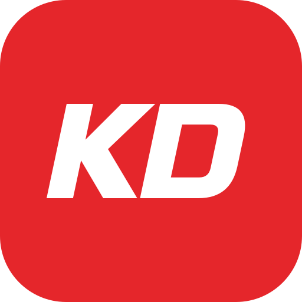
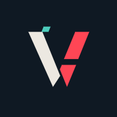

  
  
  

화면부터 데이터베이스, 서버까지 직접 설계하고 만드는 **풀스택 개발자 송덕근**입니다. 
만든 서비스를 직접 운영하면서, 실제 사용자 환경에서 생기는 문제를 해결하고 있습니다.

 

## 🖥️ On the Desk

> 지금 직접 만들고 운영하는 프로젝트

<table>
  <tr>
    <td width="50%" valign="top">
      
      <a href="https://www.pogden.com"><b>Pogden</b></a> &nbsp;<code>NEW</code>
      
작은 스트리머를 위한 라이브 스트리밍 플랫폼. 방송과 클립을 한곳에서 즐길 수 있습니다. pogden.com

    </td>
    <td width="50%" valign="top">
      
      <a href="https://www.foryoujob.com"><b>ForYouJOB</b></a>
      
중소&amp;중견기업 채용 플랫폼. 외부 채용 정보와 직접 등록된 기업 공고를 한곳에서 볼 수 있습니다. foryoujob.com

    </td>
  </tr>
  <tr>
    <td valign="top">
      
      <a href="https://www.foryoujobgw.com"><b>ForYouJOB GW</b></a>
      
작은 회사를 위한 그룹웨어. 전자결재, 메신저, 근태와 일정을 한 화면에서 다룹니다. foryoujobgw.com

    </td>
    <td valign="top">
      
      <a href="https://www.foryoumes.com"><b>ForYouMES</b></a>
      
사출금형 업체를 위한 공정관리 MES. 수주부터 출하까지 금형 하나의 흐름을 관리합니다. <a href="https://www.foryoumes.com">foryoumes.com</a> · <a href="http://112.171.0.222:8099/">112.171.0.222:8099</a>

    </td>
  </tr>
  <tr>
    <td valign="top">
      
      <a href="https://minemoa.com"><b>MineMoa</b></a>
      
마인크래프트 서버 홍보&amp;검색 플랫폼. 공식 게임 서버도 함께 운영합니다. minemoa.com

    </td>
    <td valign="top">
      
      <a href="https://apexkd.com"><b>ApexKD</b></a>
      
에이펙스 레전드 팬 사이트. 전적, 맵 로테이션, 서버 상태를 한곳에서 볼 수 있습니다. apexkd.com

    </td>
  </tr>
  <tr>
    <td valign="top">
      
      <a href="https://valkd.com"><b>ValKD</b></a>
      
발로란트 전적 검색과 경기 분석. 요원 메타, 조준점 코드, 리더보드를 볼 수 있습니다. valkd.com

    </td>
    <td valign="top">
      
      <a href="https://www.deokkeunsong.com"><b>deokkeunsong.com</b></a>
      
작업, 쓰는 장비, 취미를 기록하는 개인 홈페이지. 이 README의 디자인도 여기서 왔습니다. Personal Homepage

    </td>
  </tr>
</table>

 

## 🧭 What I Do

- **Full-Stack Development** — 화면부터 데이터베이스, 서버까지 직접 설계하고 만듭니다. 안정적이고 확장 가능한 시스템을 목표로 합니다.
- **Running Services** — 위 서비스들을 직접 배포하고 운영하며, 실제 사용자 환경에서 생기는 문제를 해결합니다.
- **Problem Solving** — <em>'핑계보다는 해결'.</em> 문제를 정확히 분석하고 현실적인 해결책을 찾습니다.
- **Continuous Learning** — 새로운 기술을 직접 써보며 익히고, 배운 것은 바로 적용합니다. 성장은 <em>'꾸준한 실행'</em>에서 나온다고 믿습니다.

 

## 🧱 Stack

> 실제 프로젝트에서 쓰고 있는 기술

**`BACK-END`** 

**`FRONT-END`** 

**`DATABASE`** 

**`SERVER & TOOLS`** 

 

## ⏱️ Log

**EXPERIENCE**

| 기간 | 회사 | 역할 |
|:--|:--|:--|
| `2026 - Now` | **The Nature Holdings** | Full-Stack Developer |
| `2021 - 2025` | **Space Solution** | Full-Stack Developer |
| `2021 - 2021` | **USFK** | Back-End Developer |
| `2019 - 2020` | **WooJin Korecen** | Back-End Developer |

**EDUCATION & POINT**

| 연도 | 항목 | 내용 |
|:--|:--|:--|
| `2026` | **학점은행제** | 컴퓨터공학과(4년제) - 공학사 학위 졸업 |
| `2019` | **데브 기어** | 델파이(C++) 정규 교육 이수 |
| `2019` | **수원과학대** | 컴퓨터정보과(3년제) - 준학사 학위 졸업 |
| `2016` | **대한민국 해병대 - 1193기** | (2015.01 ~ 2016.10) - 만기전역 |

 

  궁금한 점이나 제안은 언제든 환영합니다 — <a href="https://open.kakao.com/o/sk4Elzsh">KakaoTalk</a> · <a href="https://www.deokkeunsong.com/">Homepage</a>

